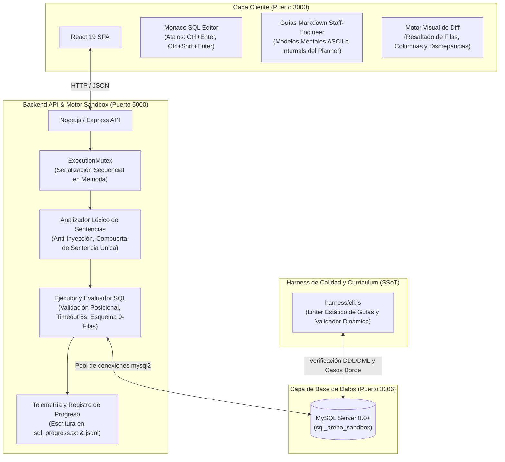

<div align="center">

# SQL Arena

**Plataforma Interactiva y Sandbox de Dominio de SQL para Entrevistas de Ingeniería de Datos**

**[English](README.md) • [Español](README.es.md)**

[](https://www.mysql.com/)
[](https://react.dev/)
[](https://expressjs.com/)
[](https://microsoft.github.io/monaco-editor/)
[](https://tailwindcss.com/)
[](#-suite-de-pruebas-y-control-de-calidad)
[](LICENSE)

*Diseñada para cerrar la brecha entre la sintaxis básica y el dominio de consultas de nivel de producción para **LeetCode SQL 50**, **HackerRank SQL (Intermediate & Advanced)** y **Entrevistas Técnicas de Data Engineering**.*

[Características](#-características-principales) • [Arquitectura](#-arquitectura) • [Currículum](#-currículum-y-dominios-técnicos) • [Inicio Rápido](#-inicio-rápido) • [Verificación](#-suite-de-pruebas-y-control-de-calidad) • [Autor](#-autor)

</div>

---

## Descripción General

**SQL Arena** es una plataforma full-stack de entrenamiento y evaluación de SQL en entorno aislado (*sandbox*), construida específicamente para ingenieros de datos y especialistas en analítica. A diferencia de los entornos en línea superficiales, SQL Arena se ejecuta sobre un motor local dedicado de **MySQL 8.0+** con un evaluador de consultas determinista, diagnóstico visual de diferencias (*diff*) en tiempo real, un arnés (*harness*) automatizado de verificación curricular y guías pedagógicas de nivel Staff Data Engineer.

Fue diseñada para erradicar sistemáticamente las trampas técnicas más sutiles y críticas de las entrevistas y entornos de producción: **Lógica Trivalente (`UNKNOWN`), Semi-Joins vs Anti-Joins (`EXISTS` / `NOT EXISTS`), filtros no SARGables, truncamiento de cadenas UTF-8 multibyte, marcos de ventana (`ROWS` vs `RANGE`), terminación de CTEs recursivas y deduplicación determinista.**

---

## Arquitectura



---

## Características Principales

### 1. Motor de Ejecución Sandbox Blindado
- **Serialización de Concurrencia en Memoria (`ExecutionMutex`):** Encola y serializa los reinicios DDL/DML del sandbox (`DROP/CREATE/INSERT`) para eliminar colisiones de descriptores de archivos en Windows NTFS (`innodb_file_per_table=1`).
- **Parser Léxico de Sentencia Única:** Tokeniza las consultas del usuario detectando comentarios anidados (`--`, `/* */`), literales de texto y paréntesis, bloqueando estrictamente intentos de inyección por sentencias múltiples (`DROP TABLE`, `GRANT`).
- **Extracción de Metadatos en Consultas de Cero Filas:** Inspecciona los paquetes `fields` del driver para preservar los nombres de columnas proyectadas incluso cuando la consulta devuelve 0 registros.
- **Verificación Posicional de Columnas:** Valida el orden exacto de proyección y alias; si las columnas están invertidas (ej. `SELECT bonus, name` en lugar de `SELECT name, bonus`), reporta `columnOrderMismatch`.
- **Timeout Estricto de 5 Segundos:** Intercepta consultas colgadas y bucles infinitos en CTEs recursivas mediante `SET SESSION max_execution_time = 5000`, devolviendo el estado controlado `TIME_LIMIT_EXCEEDED`.

### 2. Módulos Pedagógicos Nivel Staff Engineer & Harness SSoT
Cada módulo técnico sigue una especificación canónica de 6 secciones, verificada con el linter `harness/cli.js lint-topics` (las 12 guías cumplen):
1. **Procesamiento Lógico de Consultas y Álgebra Relacional Formal:** Orden real de ejecución del motor y reglas de Lógica Trivalente (3VL) de Codd.
2. **Modelos Mentales Visuales en ASCII:** Diagramas de cajas Unicode detallando marcos deslizantes de ventana, tablas de verdad 3VL y cortocircuitos en Semi-Joins.
3. **Internals de MySQL 8.0 InnoDB y Query Planner:** Análisis profundo de árboles B+ Tree, Hash Joins en memoria (`join_buffer_size`) y SARGabilidad.
4. **Modismos Canónicos de Producción (Staff Idioms):** Patrones SQL defensivos (división segura con `NULLIF` + `COALESCE`, Anti-Joins con `NOT EXISTS`).
5. **Antipatrones Reales de Producción:** Casos de estudio de fallos silenciosos con recetas de refactorización.
6. **Heurísticas para Entrevistas FAANG y HackerRank:** Reglas rápidas de reconocimiento de patrones bajo presión de tiempo.

### 3. Motor de Diff Visual y Telemetría en Tiempo Real
- **Comparación Instantánea de Resultados:** Evalúa la salida del estudiante contra la solución canónica verificando columnas, conteo de filas y valores normalizados en punto flotante IEEE-754.
- **Telemetría Local Automatizada:** Cada envío se registra en `sql_progress.txt` y `logs/sql_submissions.jsonl` con latencia en milisegundos, código ejecutado y estado.
- **Persistencia de Borradores:** Guardado automático en `localStorage` por ejercicio para no perder nunca el progreso en el editor.

---

## Currículum y Dominios Técnicos

SQL Arena cuenta con **36 ejercicios progresivos** distribuidos en **12 dominios técnicos fundamentales**:

| # | Módulo Técnico | Conceptos Clave y Enfoque | Problemas Destacados |
|---|----------------|---------------------------|----------------------|
| 1 | **Manejo de Nulos y 3VL** | Lógica trivalente (`UNKNOWN`), `IFNULL`, `COALESCE`, `NULLIF`, anti-joins seguros. | *Bono de Empleados*, *Reconciliación con IFNULL*, *Trampa de NOT IN* |
| 2 | **Redondeo y Aritmética** | `ROUND()`, `TRUNCATE()`, agregación condicional, precisión en punto flotante. | *Tiempo Promedio por Máquina*, *Tasa de Confirmación* |
| 3 | **Joins Avanzados** | Diferencia crítica entre `ON ... AND` y `WHERE`, triple joins, self-joins jerárquicos. | *Visitas sin Transacción*, *Triple Join de Catálogo*, *Empleados y Supervisores* |
| 4 | **Fechas e Intervalos** | `DATEDIFF()`, `DATE_SUB()`, ventanas móviles de 30 días, retención de cohorte Día 1. | *Temperaturas Crecientes*, *Usuarios Activos 30 Días*, *Retención Día 1 (LC 550)* |
| 5 | **Deduplicación Analítica** | `ROW_NUMBER() = 1` vs `RANK() = 1`, desempates deterministas, último registro por clave. | *Deduplicación Analítica*, *Materias Únicas*, *Último Registro por Usuario* |
| 6 | **Manipulación de Strings** | Caracteres lógicos `CHAR_LENGTH()` vs bytes físicos `LENGTH()`, `CONCAT`, UTF-8. | *Corrección de Nombres*, *Tweets Inválidos (Multibyte Safe)* |
| 7 | **CTEs Encadenadas** | Pipelines modulares `WITH a AS (...), b AS (...)`, legibilidad y alcance de CTEs. | *Salarios sobre Promedio Departamental*, *Región Líder en Ventas* |
| 8 | **Subconsultas Correlacionadas**| Subconsultas escalares y correlacionadas, filtrado de agregaciones, detección de huérfanos. | *Gerentes con ≥5 Reportes*, *Empleados cuyo Manager Dejó la Empresa* |
| 9 | **Window Functions** | `OVER()`, `ROW_NUMBER`, `RANK`, `DENSE_RANK`, `LEAD`/`LAG`, `ROWS BETWEEN`. | *Números Consecutivos*, *Suma Acumulativa*, *Media Móvil*, *Top 3 Salarios (LC 185)* |
| 10| **CTEs Recursivas** | `WITH RECURSIVE`: caso ancla + paso recursivo, recorridos jerárquicos, series de fechas. | *Niveles del Organigrama*, *Calendario con Días sin Pedidos* |
| 11| **Pivots Condicionales** | Transformación de filas a columnas mediante `CASE WHEN` y `SUM()` / `MAX()`. | *Ventas por Trimestre*, *Occupations (Clásico de HackerRank)* |
| 12| **Predicados de Existencia** | `EXISTS`, `NOT EXISTS`, evaluación por cortocircuito, Semi-Joins CBO, el mito de `SELECT 1`. | *Clientes de Alto Valor (Semi-Join)*, *Departamentos sin Personal Activo (Anti-Join)* |

---

## Suite de Pruebas y Control de Calidad

SQL Arena cuenta con una batería de pruebas adversariales y un arnés de validación curricular (`harness/cli.js`) con **141 verificaciones automatizadas**:

```text
======================================================================
SQL ARENA VERIFICATION BATTERY (141 / 141 CHECKS PASSING)
======================================================================
  test_all_problems.js                 36 / 36 PASS  (Soluciones de referencia en MySQL)
  test_adversarial_m1.js               28 / 28 PASS  (Mutaciones de sintaxis, comentarios, inyeccion)
  test_adversarial_m2_challenger.js    28 / 28 PASS  (Consultas con parentesis, espacios, hallazgos de borde)
  test_curriculum_edge_cases.js        18 / 18 PASS  (Empates, IDs discontinuos, bytes UTF-8)
  test_edge_cases.js                   10 / 10 PASS  (Proyeccion 0-filas, formato BigNumber)
  test_runner_regression.js             7 /  7 PASS  (Orden posicional, ocultamiento de solucion)
  test_api_security.js                  8 /  8 PASS  (Validacion, limites de tamano, rate limiting, sentencias apiladas)
  test_stress_challenger.js             6 /  6 PASS  (Rafagas de concurrencia, recuperacion de timeouts)
======================================================================
```

### CLI del Harness de Ingeniería:
```bash
# Auditar que las guías teóricas cumplan las 6 secciones obligatorias de nivel Staff Engineer
node harness/cli.js lint-topics

# Validar un ejercicio específico contra el Sandbox de MySQL 8 (DDL, DML, solución y tablas vacías)
node harness/cli.js test-problem exists-2

# Ejecutar la validación integral de guías y ejercicios
node harness/cli.js validate-all
```

---

## Inicio Rápido

### Requisitos Previos
- **Node.js** (v18.0 o superior)
- **MySQL Server** (v8.0+ ejecutándose localmente en el puerto `3306`)

### 1. Clonar e Instalar Dependencias
```bash
git clone https://github.com/bapatata688/SQL_arena.git
cd SQL_arena
npm run install:all
```

### 2. Configurar el Entorno
Crea la base de datos de pruebas en tu servidor MySQL:
```sql
CREATE DATABASE IF NOT EXISTS sql_arena_sandbox;
```
Configura tu archivo `.env` en `backend/` (o copia `.env.example`):
```env
PORT=5000
DB_HOST=127.0.0.1
DB_PORT=3306
DB_USER=root
DB_PASSWORD=
DB_NAME=sql_arena_sandbox
```

### 3. Iniciar la Plataforma

#### En Windows (PowerShell Un Solo Clic):
```powershell
.\scripts\start.ps1
```

#### En Linux / macOS:
```bash
chmod +x ./scripts/start.sh
./scripts/start.sh
```

#### O mediante npm:
```bash
# Terminal 1: Backend
npm run dev:backend

# Terminal 2: Frontend
npm run dev:frontend
```

Abre [http://localhost:3000](http://localhost:3000) en tu navegador.

---

## ⌨Atajos del Editor

| Atajo | Acción | Descripción |
|---|---|---|
| `Ctrl + Enter` | **Ejecutar (Run)** | Ejecuta la consulta contra el sandbox del problema activo. |
| `Ctrl + Shift + Enter` | **Enviar (Submit)** | Evalúa contra la solución oficial y registra el intento en la telemetría. |

---

## Estructura del Proyecto

```text
SQL_arena/
├── .github/
│   └── workflows/
│       └── ci.yml             # Pipeline CI en GitHub Actions con contenedor MySQL 8.0
├── backend/
│   ├── curriculum/            # Catálogos JSON sincronizados de temas y problemas
│   ├── db.js                  # Pool de conexiones MySQL2
│   ├── runner.js              # Motor de ejecución aislado por Mutex y evaluador de Diff
│   ├── server.js              # API Express blindada (Rate-limiting, CORS, validaciones)
│   ├── telemetry.js           # Registro de progreso en sql_progress.txt y jsonl
│   ├── problems_data.js       # Definición de problemas base, esquemas y semillas
│   ├── problems_advanced.js   # Problemas avanzados (Recursión, Pivot, Window, Exists)
│   └── test_*.js              # 8 suites de pruebas automatizadas
├── frontend/
│   ├── src/
│   │   ├── components/        # Monaco editor, Navbar, Consola de Diff, Guías
│   │   ├── App.jsx            # Gestión de estado, caché de borradores y atajos
│   │   └── index.css          # Estilos con Tailwind CSS v4
│   └── vite.config.js         # Configuración de proxy y empaquetado
├── harness/
│   ├── cli.js                 # CLI unificado para auditoría de guías y validación en MySQL
│   ├── templates/             # Plantillas canónicas para nuevos módulos y ejercicios
│   └── validators/            # Verificadores estáticos y dinámicos
├── docs/
│   └── ARCHITECTURE_REVIEW_AND_QA_DIAGNOSTIC.md
├── scripts/
│   ├── start.ps1              # Lanzador automático para Windows
│   └── start.sh               # Lanzador automático para Unix/macOS
├── .env.example
├── .gitignore
├── LICENSE                    # Licencia MIT
├── package.json               # Scripts del monorepo
├── README.md                  # Documentación Principal (Inglés)
└── README.es.md               # Documentación Completa (Español)
```

---

## Autor

**Diego Alejandro Escobar Barahona**  
*Data Engineer & Cloud Specialist*  
Soyapango, El Salvador  

- **Certificaciones:** Google Cloud Certified — Associate Data Practitioner (ADP) • EF SET English C1 Advanced
- **GitHub:** [github.com/bapatata688](https://github.com/bapatata688)
- **LinkedIn:** [linkedin.com/in/diego-escobar-459256394](https://www.linkedin.com/in/diego-escobar-459256394)
- **Contacto:** diegoalejandroescobarahona1@gmail.com

---

## Licencia

Este proyecto está distribuido bajo la [Licencia MIT](LICENSE).
