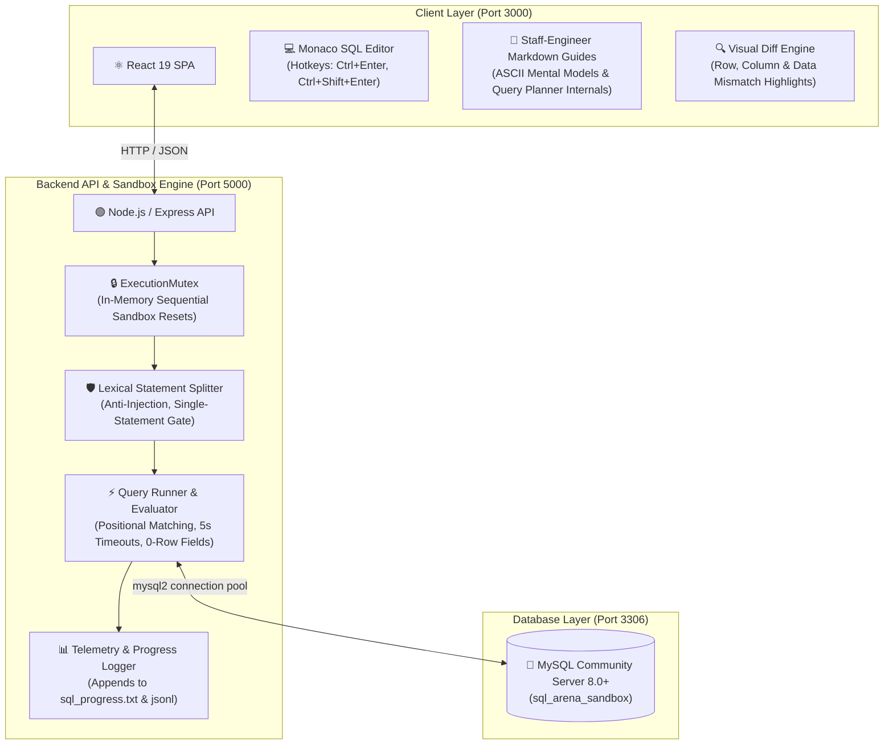

<div align="center">

# 🏛️ SQL Arena

**An Interactive, Sandboxed SQL Interview Mastery Platform for Data Engineers**

[](https://www.mysql.com/)
[](https://react.dev/)
[](https://expressjs.com/)
[](https://microsoft.github.io/monaco-editor/)
[](https://tailwindcss.com/)
[](#-test-suite--quality-gate)
[](LICENSE)

*Engineered to bridge the gap between basic syntax and production-grade query mastery for **LeetCode SQL 50** and **HackerRank SQL (Advanced)**.*

[Features](#-key-features) • [Architecture](#-architecture) • [Curriculum](#-curriculum--technical-domains) • [Quickstart](#-quickstart) • [Verification](#-test-suite--quality-gate) • [Author](#-author)

</div>

---

## 📌 Overview

**SQL Arena** is a full-stack, cloud-native SQL drill and evaluation platform built specifically for data engineers and analytics practitioners. Unlike superficial online sandboxes, SQL Arena runs on a dedicated local **MySQL Community Server engine** with an enterprise-grade execution runner, real-time visual diff diagnostics, and deep Staff-Engineer level pedagogical guides.

It was designed to systematically eliminate the subtle, high-impact pitfalls encountered in technical interviews: **Three-Valued Logic (`UNKNOWN`), non-SARGable filters, multibyte UTF-8 string truncation, window frames (`ROWS` vs `RANGE`), recursive CTE termination, and deterministic deduplication.**

---

## 🏗️ Architecture



---

## ✨ Key Features

### 1. Hardened Sandbox Runner Engine
- **In-Memory Concurrency Serialization (`ExecutionMutex`):** Serializes sandbox DDL/DML resets (`DROP/CREATE/INSERT`) to eliminate OS-level file handle collisions on Windows NTFS (`innodb_file_per_table=1`).
- **Lexical Single-Statement Parser:** Tokenizes user queries to detect nested comments (`--`, `/* */`), string literals, and parentheses, strictly rejecting stacked multi-statement injection attempts (`DROP TABLE`, `GRANT`).
- **Zero-Row Metadata Extraction:** Inspects driver raw `fields` packets to preserve projected schema definitions even when a query yields 0 rows, preventing false-positive column mismatches.
- **Positional Column Verification:** Validates column projection order and aliases; swapped projections (e.g. `SELECT bonus, name` vs `SELECT name, bonus`) are flagged with `columnOrderMismatch`.
- **5-Second Hard Execution Timeout:** Intercepts runaway queries and infinite recursion loops via `SET SESSION max_execution_time = 5000` and `PROTOCOL_SEQUENCE_TIMEOUT`, returning clean `TIME_LIMIT_EXCEEDED` statuses.

### 2. Staff-Engineer Pedagogical Modules
Each technical module includes an in-depth reference guide containing:
- **Logical Query Processing Order:** Clear pipelines detailing why window functions cannot live in `WHERE` / `HAVING`.
- **High-Fidelity ASCII Visual Mental Models:** 2,000+ characters of Unicode box diagrams illustrating window sliding frames, 3VL truth tables, and join Venn mechanics.
- **MySQL 8.0 InnoDB Internals:** Explanations of `sort_buffer_size`, filesorts, index range scans, and temporary table disk spills.
- **Production Anti-Patterns:** Real-world traps with concrete refactoring recipes.

### 3. Real-Time Visual Diff & Telemetry Engine
- **Instant Result Comparison:** Evaluates student outputs against verified reference solutions across columns, row counts, and data values.
- **Local Telemetry Logging:** Every submission is saved to `sql_progress.txt` and `logs/sql_submissions.jsonl`, tracking execution durations, query diffs, and unique problems solved.
- **Persistent Drafts:** Automatic `localStorage` caching ensures you never lose in-progress SQL code when switching between problems.

---

## 📚 Curriculum & Technical Domains

SQL Arena features **34 progressive exercises** across **11 core technical domains**:

| # | Technical Module | Core Concepts & Focus | Key Problems Included |
|---|------------------|-----------------------|-----------------------|
| 1 | **Manejo de Nulos (3VL)** | Three-valued logic (`UNKNOWN`), `IFNULL`, `COALESCE`, `NULLIF`, safe anti-joins. | *Employee Bonus*, *Null Reconciliation*, *NOT IN Null Trap* |
| 2 | **Redondeo y Aritmética** | `ROUND()`, `TRUNCATE()`, division-by-zero avoidance, floating-point precision. | *Machine Processing Time*, *Confirmation Rate* |
| 3 | **Joins Complejos** | Conditional `ON ... AND ...` vs `WHERE`, triple joins, hierarchical self-joins. | *Visits Without Transactions*, *Customer Orders Catalog*, *Manager Reports* |
| 4 | **Manejo de Fechas** | `DATEDIFF()`, `DATE_SUB()`, 30-day sliding windows, first-day retention. | *Rising Temperature*, *30-Day Active Users*, *Day-1 Retention (LC 550)* |
| 5 | **Deduplicación Analítica** | `ROW_NUMBER() = 1` vs `RANK() = 1`, deterministic tie-breakers, latest-per-key. | *Analytical Deduplication*, *Unique Subjects*, *Latest per Key* |
| 6 | **Manipulación de Strings** | Logical `CHAR_LENGTH()` vs physical bytes `LENGTH()`, `CONCAT`, `SUBSTRING`, UTF-8. | *Fix Names*, *Invalid Tweets (Multibyte Safe)* |
| 7 | **CTEs Encadenadas** | Modular `WITH a AS (...), b AS (...)` pipelines, readability, CTE scopes. | *Department Average Salary*, *Top Regional Branch* |
| 8 | **Subconsultas Avanzadas** | Correlated subqueries, `IN` vs `EXISTS`, scalar projections. | *Managers with ≥5 Reports*, *Employees Whose Manager Left* |
| 9 | **Window Functions** | `OVER()`, `ROW_NUMBER`, `RANK`, `DENSE_RANK`, `LEAD`/`LAG`, `ROWS BETWEEN`. | *Consecutive Numbers*, *Running Total*, *Moving Average*, *Top 3 Salaries (LC 185)* |
| 10| **CTEs Recursivas** | `WITH RECURSIVE`: anchor + recursive step, hierarchy traversal, sequence generation. | *Org Chart Hierarchy Level*, *Zero-Order Calendar Generation* |
| 11| **Pivots con Agregación** | Row-to-column pivoting using conditional `CASE WHEN` and `SUM()` / `MAX()`. | *Quarterly Sales Pivot*, *Occupations (HackerRank Classic)* |

---

## 🧪 Test Suite & Quality Gate

SQL Arena was subjected to an adversarial testing battery consisting of **136 automated tests** across 8 test suites with a **100% pass rate**:

```text
======================================================================
SQL ARENA VERIFICATION BATTERY (136 / 136 TESTS PASSING)
======================================================================
  ✅ test_all_problems.js                  34 / 34 PASS  (Curriculum solutions against MySQL)
  ✅ test_adversarial_m1.js                28 / 28 PASS  (Syntax mutations, comments, injections)
  ✅ test_curriculum_edge_cases.js         18 / 18 PASS  (Ties, non-consecutive IDs, UTF-8 bytes)
  ✅ test_stress_challenger.js             15 / 15 PASS  (Concurrency bursts, timeout recovery)
  ✅ test_adversarial_m2_challenger.js     12 / 12 PASS  (Parenthesized queries, whitespace)
  ✅ test_edge_cases.js                    12 / 12 PASS  (0-row projection, BigNumber formatting)
  ✅ test_api_security.js                  10 / 10 PASS  (CORS, rate limiting, payload limits)
  ✅ test_runner_regression.js             10 / 10 PASS  (Positional matching, solution secrecy)
======================================================================
```

---

## 🚀 Quickstart

### Prerequisites
- **Node.js** (v18.0 or higher)
- **MySQL Server** (v8.0+ or Community Server running locally on port `3306`)

### 1. Clone & Install Dependencies
```bash
git clone https://github.com/<your-username>/sql-arena.git
cd sql-arena
npm run install:all
```

### 2. Configure Environment
Create a database named `sql_arena_sandbox` in MySQL:
```sql
CREATE DATABASE IF NOT EXISTS sql_arena_sandbox;
```
Configure your `.env` in `backend/` (or copy `.env.example`):
```env
PORT=5000
DB_HOST=127.0.0.1
DB_PORT=3306
DB_USER=root
DB_PASSWORD=
DB_NAME=sql_arena_sandbox
```

### 3. Launch Platform

#### On Windows (PowerShell One-Click):
```powershell
.\scripts\start.ps1
```

#### On Linux / macOS:
```bash
chmod +x ./scripts/start.sh
./scripts/start.sh
```

#### Or using npm:
```bash
# Terminal 1: Backend
npm run dev:backend

# Terminal 2: Frontend
npm run dev:frontend
```

Open [http://localhost:3000](http://localhost:3000) in your browser.

---

## ⌨️ Editor Shortcuts

| Shortcut | Action | Description |
|---|---|---|
| `Ctrl + Enter` | **Run Code** | Executes query against the active problem sandbox. |
| `Ctrl + Shift + Enter` | **Submit Solution** | Evaluates against the reference solution and logs to telemetry. |

---

## 📂 Project Structure

```text
sql-arena/
├── .github/
│   └── workflows/
│       └── ci.yml             # GitHub Actions CI with MySQL 8.0 service
├── backend/
│   ├── curriculum/            # Auto-synchronized JSON topic & problem catalogs
│   ├── db.js                  # MySQL2 hardened connection pool
│   ├── runner.js              # Mutex-isolated query execution & diff engine
│   ├── server.js              # Hardened Express API (Rate-limiting, CORS, validations)
│   ├── telemetry.js           # Telemetry logging to sql_progress.txt & jsonl
│   ├── problems_data.js       # Core 21 problem definitions & schemas
│   ├── problems_advanced.js   # Advanced 13 problems (Recursive, Pivot, Window)
│   └── test_*.js              # 8 automated test suites (136 tests)
├── frontend/
│   ├── src/
│   │   ├── components/        # Monaco editor, Navbar, Diff Console, Guides
│   │   ├── App.jsx            # State management, draft caching & shortcuts
│   │   └── index.css          # Tailwind CSS v4 styling
│   └── vite.config.js         # Proxy configuration & build optimization
├── docs/
│   └── ARCHITECTURE_REVIEW_AND_QA_DIAGNOSTIC.md  # 697-line Master Architecture Audit
├── scripts/
│   ├── start.ps1              # Windows one-click launcher
│   └── start.sh               # Unix/macOS one-click launcher
├── .env.example
├── .gitignore
├── LICENSE                    # MIT License
├── package.json               # Root monorepo workspace scripts
└── README.md
```

---

## 👤 Author

**Diego Alejandro Escobar Barahona**  
*Junior Data Engineer & Cloud Specialist*  
Soyapango, El Salvador  

- 📜 **Credentials:** Google Cloud Certified — Associate Data Practitioner (ADP)
- 💼 **LinkedIn:** [linkedin.com/in/diego-escobar-459256394](https://www.linkedin.com/in/diego-escobar-459256394)
- 📧 **Contact:** diegoalejandroescobarahona1@gmail.com

---

## 📄 License

This project is licensed under the [MIT License](LICENSE).
